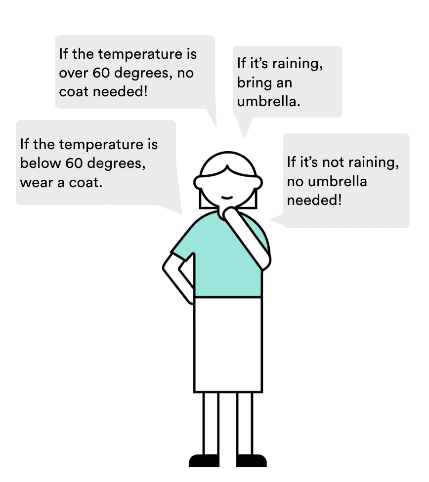
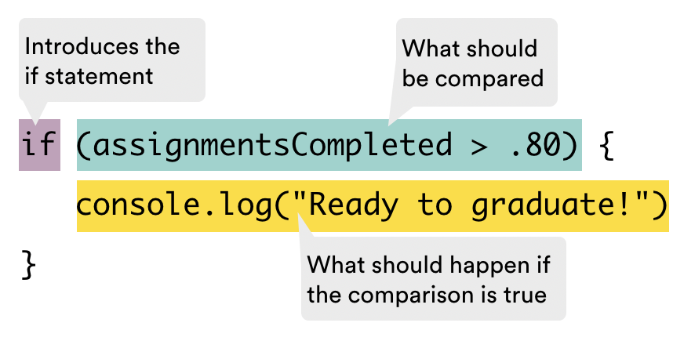
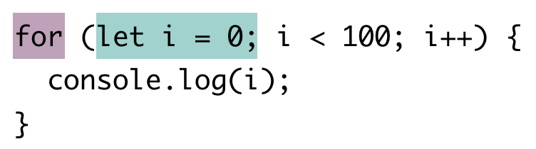
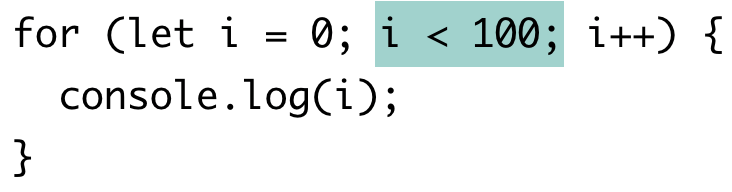
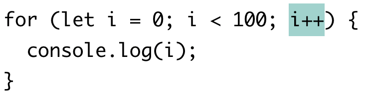
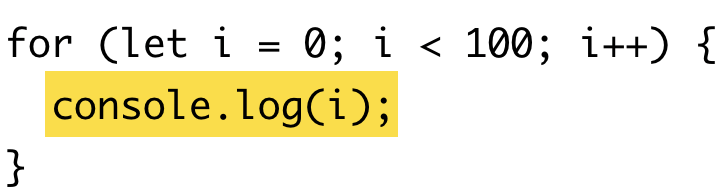

<textarea id="source">

<h1 class="slide-header">Control Flow</h1>

<span id=time-estimate class="color-grey-500">60 mins</span>

<p id="lesson-description">
Wouldn't it be great if we could tell a computer to make the perfect sandwich? While we’re not quite there yet, we <strong>can</strong> program computers to make decisions based on specific conditions using logic.

Computers rely on <strong>comparisons and rules</strong> to determine what actions to take. Even complex programs are built on simple decision-making processes. Let’s explore how that works!

</p>

<h5 id="topics-header" class="color-grey-500">Topics</h5>

Control Flow

<hr>

Conditionals

<hr>

Loops

<hr>

<a href="./assets/control_flow_study_guide.pdf" target="_blank" download="control_flow_study_guide.pdf" class="ant-btn" data-trackable="true" data-track-category="study guide" data-track-section="lesson page" data-track-action="download study guide"><span role="img" class="anticon"><svg viewBox="0 0 16 16" width="1em" height="1em" fill="currentColor" aria-hidden="true" focusable="false" class=""><g class="download_svg__nc-icon-wrapper"><path d="M8 12c.3 0 .5-.1.7-.3L14.4 6 13 4.6l-4 4V0H7v8.6l-4-4L1.6 6l5.7 5.7c.2.2.4.3.7.3z"></path><path data-color="color-2" d="M1 14h14v2H1z"></path></g></svg></span><span> Download Study Guide</span></a>

---

<h1 class="slide-header">Learning Objectives</h1>

<p>By the end of this lesson, you'll be able to:</p>

<ul>
  <li>Use comparison operators to compare data.</li>
  <li>Create conditional statements to control the flow of your program.</li>
  <li>Write “for” and “while” loops.</li>
</ul>

---

<h1 class="slide-header">Comparison Statements</h1>

Computers make decisions by comparing values. They ask questions like:

- **Are two values equal?**
- **Is one number greater or smaller than another?**

These comparisons always result in a **Boolean value**: `true` or `false`.

**Comparison Operators in JavaScript**

| Operator | What It Does                                                              | Example Usage         | Result |
| -------- | ------------------------------------------------------------------------- | --------------------- | ------ |
| `>`      | Checks if the left value is **greater than** the right value.             | `5 > 2`               | `true` |
| `>=`     | Checks if the left value is **greater than or equal to** the right value. | `5 >= 5`              | `true` |
| `<`      | Checks if the left value is **less than** the right value.                | `2 < 200`             | `true` |
| `<=`     | Checks if the left value is **less than or equal to** the right value.    | `1 <= 72`             | `true` |
| `==`     | **Loose equality** (checks if values are equal, but ignores data types).  | `5 == "5"`            | `true` |
| `===`    | **Strict equality** (checks if values AND data types are the same).       | `"apple" === "apple"` | `true` |
| `!==`    | **Inequality** (checks if values OR data types are different).            | `5 !== "5"`           | `true` |

Comparison operators are **essential for making decisions** in JavaScript. They help programs **compare values** and decide what actions to take.

Next, we’ll see how to use these comparisons inside **conditional statements** to control the flow of our code!

---

<h1 class="slide-header">Loose and Strict Equality</h1>

Equality operators can be **tricky** in JavaScript, so let’s break them down.

**Loose Equality `==`**

- **Allows type conversion** (JavaScript tries to match data types before comparing).
- This process is called **type coercion**.

```js
console.log('4' == 4); // true (string "4" is converted to a number)
console.log(4 == 4); // true (same number)
console.log(5 == 4); // false (different numbers)
```

**Strict Equality `===`**

- Compares both value AND data type (no conversions).

```js
console.log('4' === 4); // false (string vs. number)
console.log(4 === 4); // true (same number, same type)
```

**Strict Inequality `!==`**

- Returns `true` if either the value _or_ type is different.

```js
console.log('4' !== 4); // true (string vs. number)
console.log(4 !== 4); // false (same number, same type)
```

**Best Practice:**

- Loose comparisons `==` can lead to **unexpected results**.
- Always use **strict equality `===` and strict inequality `!==`** for accurate comparisons.

---

<h1 class="slide-header">Knowledge Check</h1>

Which of the following expressions will evaluate to **`true`**?

Review the comparison and equality operators carefully before selecting your answers.

<fieldset>
  <legend>Please select all that apply:</legend>
  <input type="checkbox" id="option-one" name="option-one" correct="true" />
  <label for="option-one">"Baked Brie" !== "baked brie"</label>
  <br />
  <input type="checkbox" id="option-two" name="option-two" correct="true" />
  <label for="option-two">17 == "17"</label>
  <br />
  <input type="checkbox" id="option-three" name="option-three" />
  <label for="option-three">17 === "17"</label>
  <br />
  <input type="checkbox" id="option-four" name="option-four" />
  <label for="option-four">5 * 5 < 20</label>
  <br />
  <input type="checkbox" id="option-five" name="option-five" correct="true"/>
  <label for="option-five">99 >= 99</label>
  <br />
</fieldset>

<button class="ant-btn ant-btn-primary multiple-choice-checkbox-submit">
  Submit Answer
</button>
	
---

<h1 class="slide-header">Using Comparisons to Create Conditionals</h1>

Comparison statements are useful, but on their own, they don’t do much. After all, you don’t need a computer to tell you that `100 > 1`.

The real power of **comparisons** comes when they are used inside **conditional statements**. Conditionals allow programs to **make decisions**—controlling what happens, when it happens, and how it happens.

Think about how you make decisions in daily life. For example, when getting ready in the morning, you might think:

- **"If it's raining, I'll take an umbrella."**
- **"If I'm late, I'll skip making coffee."**

Computers follow this same kind of **logic-based decision-making** to execute different actions based on conditions. Let’s explore how that works in JavaScript!



---

<h1 class="slide-header">Conditionals in Programming</h1>

In many ways, a computer **processes conditionals** just like a human brain does—it evaluates a situation and makes a decision based on the result.

In JavaScript, we use **`if` statements** to tell the computer:

- **"If a condition is true, execute this code."**
- **"Otherwise, skip it or do something else."**

Example:

```javascript
if (assignmentsCompleted > 0.8) {
  console.log('Ready to graduate!');
}
```

In simple terms, this means:

_"If assignments completed are greater than 80%, display 'Ready to graduate!'"_

Conditional statements allow programs to **make decisions dynamically**, just like we do in real life.

---

<h1 class="slide-header">Breaking Down Conditionals</h1>

An **`if` statement** has three key parts:

1. **The `if` keyword** → Signals that a condition is being checked.
2. **The condition inside parentheses `( )`** → This is the comparison being evaluated.
3. **The code block inside `{ }`** → Runs **only if** the condition is `true`.

If the comparison evaluates to `true`, the code inside the curly braces executes. Otherwise, it is skipped.



---

<h1 class="slide-header">Quick Review</h1>

Let’s revisit some everyday decision-making:

- **"If the temperature is cold, wear a coat."**
- **"If it’s raining, bring an umbrella."**

How would you write these as **conditional statements** in JavaScript?

Example Solution:

```js
if (temperature === 'cold') {
  console.log('Wear a coat!');
}

if (weather === 'raining') {
  console.log('Bring an umbrella!');
}
```

---

<h1 class="slide-header">Expanding Conditionals with <code>else</code></h1>

So far, our **`if` statements** only run code **when the condition is `true`**. But what if we want something to happen when the condition is **`false`**?

We can extend an `if` statement using an **`else` block**, which tells the computer what to do **if the condition is not met**.

Example:

```js
if (assignmentsCompleted > 0.8) {
  console.log('Ready to graduate!');
} else {
  console.log('Better catch up on your homework!');
}
```

This tells JavaScript:

- **If** assignments completed are **greater than 80%**, print `"Ready to graduate!"`.
- **Otherwise** (if the condition is false), print `"Better catch up on your homework!"`.

This makes our programs **more dynamic** by handling both possibilities.

---

<h1 class="slide-header">Adding More Conditions with <code>else if</code></h1>

Sometimes, we need to check **more than two conditions**. In these cases, we can use an **`if ... else if ... else`** chain.

The **first condition that evaluates to `true`** is executed, and the rest are ignored.

Example:

```js
if (assignmentsCompleted > 0.8) {
  console.log('Ready to graduate!');
} else if (assignmentsCompleted > 0.65) {
  console.log('Better catch up on your homework!');
} else {
  console.log('You’ve got a lot of work left to do.');
}
```

- **If** assignments completed are **above 80%**, print `"Ready to graduate!"`.
- **Otherwise, if** assignments are above **65%**, print `"Better catch up on your homework!"`.
- **If none of the conditions are met**, print `"You’ve got a lot of work left to do."`.

This allows us to handle **multiple possible outcomes** with a structured decision-making process.

---

<h1 class="slide-header">Nesting Conditionals for More Complex Logic</h1>

What if we need to make **decisions within decisions**? We can **nest `if` statements inside other `if` statements** to handle **more detailed conditions**.

For example, deciding what to wear isn’t just about temperature—it also depends on the weather.

Example:

```js
if (temperature < 60) {
  if (weather === 'raining') {
    console.log("It's cold and raining. Time for a heavy rain jacket.");
  } else if (weather === 'snowing') {
    console.log("It's cold and snowing. Get out the parka.");
  } else {
    console.log("It's cold and clear. Feels like sweater weather today.");
  }
} else {
  if (weather === 'raining') {
    console.log("It's warm but it's raining. A light windbreaker will do.");
  } else if (weather === 'sunny') {
    console.log("It's warm and sunny. Tank top it is.");
  } else {
    console.log("It's warm and clear. Regular old T-shirt day.");
  }
}
```

- **First, we check the temperature** (`if temperature < 60`).
- **If it’s cold**, we check whether it’s raining, snowing, or clear.
- **If it’s warm**, we check whether it’s raining, sunny, or clear.

This structure **mirrors real-life decision-making**, where different conditions affect the final choice!

---

<h1 class="slide-header">Logical Operators</h1>

So far, our conditionals have only checked **one** comparison at a time. But what if we need to check **multiple conditions together**?

We can combine comparisons using **logical operators**:

- **AND (`&&`)** → Both conditions must be `true`.
- **OR (`||`)** → At least one condition must be `true`.
- **NOT (`!`)** → Reverses a condition’s truth value.

**Example: Using `&&` (AND)**
If we only want to wear a windbreaker **when it’s both cold AND windy**, we can write:

```js
if (temperature === 'cold' && windSpeed > 10) {
  console.log('Time for the windbreaker!');
}
```

**Example: Using `||` (OR)**  
If we need boots **when it’s either snowing OR raining**, we use `||`:

```js
if (weather === 'snowing' || weather === 'raining') {
  console.log('Looks like we need to wear boots today.');
}
```

Logical operators allow us to make **more flexible decisions** in our programs by combining multiple conditions!

---

<h1 class="slide-header">Your turn: Writing Conditionals</h1>

Conditionals allow programs to **make decisions based on user input**.

For the next few challenges, you’ll write code inside a **function**—don’t worry, we’ll cover functions soon! For now, focus on writing **conditional logic** inside the function to test different cases.

Inside this function, you’ll have access to a variable called **`isWearingSeatbelt`**.

Write a conditional statement that:

- **If `isWearingSeatbelt` is `true`**, logs: `"Great job! Always wear your seatbelt for safety."`
- **If `isWearingSeatbelt` is `false`**, logs: `"Remember to put on your seatbelt before driving!"`

Try writing the conditional statement and testing how it behaves with different values!

<iframe sandbox="allow-scripts allow-top-navigation allow-top-navigation-by-user-activation allow-forms allow-popups allow-same-origin"  height="400" style="width: 100%;" scrolling="no" title="Buckle Up for Conditionals" src="https://codepen.io/GAmarketing/embed/jORVedN?default-tab=js%2Cresult&editable=true" frameborder="no" loading="lazy" allowtransparency="true" allowfullscreen="true">
    See the Pen <a href="https://codepen.io/GAmarketing/pen/jORVedN">
    Buckle Up for Conditionals</a> by General Assembly (<a href="https://codepen.io/GAmarketing">@GAmarketing</a>)
    on <a href="https://codepen.io">CodePen</a>.
</iframe>

---

<h1 class="slide-header">A Tense Negotiation</h1>

In this challenge, you’ll program a **conditional sequence** to respond to a given `price` input.

Write a conditional statement that evaluates the `price` variable and logs the appropriate response:

1. **If `price` is less than `5`**, log:

```js
"I'll take it!";
```

2. **If `price` is greater than `10`**, log:

```js
price + ' for this? That’s too expensive!';
```

_(Use string concatenation to insert the price into the message.)_

3. **If the price is between `5` and `10` (inclusive), log:**

```js
"Take off 10% and you've got a deal.";
```

Try writing your conditional statement and testing different `price` values to see how the program responds!

<iframe sandbox="allow-scripts allow-top-navigation allow-top-navigation-by-user-activation allow-forms allow-popups allow-same-origin"  height="400" style="width: 100%;" scrolling="no" title="A Tense Negotiation" src="https://codepen.io/GAmarketing/embed/ZEZBqwQ?default-tab=js%2Cresult&editable=true" frameborder="no" loading="lazy" allowtransparency="true" allowfullscreen="true">
    See the Pen <a href="https://codepen.io/GAmarketing/pen/ZEZBqwQ">
    A Tense Negotiation</a> by General Assembly (<a href="https://codepen.io/GAmarketing">@GAmarketing</a>)
    on <a href="https://codepen.io">CodePen</a>.
</iframe>

---

<h1 class="slide-header">Introducing Loops</h1>

Conditionals allow programs to make **decisions**, but what if we need to **repeat actions multiple times**? That’s where **loops** come in.

In programming, a **loop** runs a block of code **as long as a condition is met**. Loops help automate repetitive tasks, making our programs more efficient.

We’ll cover two important types of loops in JavaScript:

- **`for` loops** → Best for when you know **exactly** how many times to repeat.
- **`while` loops** → Best for when the repetition depends on a condition.

Let’s explore how each one works!

---

<h1 class="slide-header">For Loops</h1>

A **`for` loop** is great when you need to run code **a specific number of times**.

At first glance, the syntax might look complicated, but don’t worry! It follows a structure we can break down step by step.

Example: Counting from `0` to `99`

```js
for (let i = 0; i < 100; i++) {
  console.log(i);
}
```

**Understanding the Syntax:**

- **`let i = 0`** → Start counting from `0`.
- **`i < 100`** → Keep looping while `i` is less than `100`.
- **`i++`** → Increase `i` by `1` after each loop.

This loop prints numbers from **0 to 99**, stopping before `100`.

For loops are **precise and efficient**, making them ideal for situations where you know exactly how many times a task should repeat.

---

<h1 class="slide-header">Knowledge Check</h1>

Before we dive into `for` loop syntax, let’s take a moment to **think critically** about how loops work.

Take a guess: What do you think this `for` loop will do?

```js
for (let i = 0; i < 5; i++) {
  console.log(i);
}
```

Try breaking it down step by step:

- **Where does `i` start?**
- **When does the loop stop?**
- **What happens inside the loop?**

<fieldset>
    <legend>Please select one of the following</legend>
<input type='radio' name='answers' id='answer1' value='answer1' correct='true'/><label for='answer1'>Count every number from 0 up to, but not including, 5.</label><br />
<input type='radio' name='answers' id='answer2' value='answer2' /><label for='answer2'>Count every number from 0 up to, and including, 5</label><br />
<input type='radio' name='answers' id='answer3' value='answer3' /><label for='answer3'>Add 2 to each number, starting at 0, until it reaches 5</label><br />
</fieldset>
<button class='ant-btn ant-btn-primary multiple-choice-radio-submit'>Submit Answer</button>

---

<h1 class="slide-header">Breaking Down a For Loop</h1>

A `for` loop consists of three key parts inside the parentheses `( )`, plus the code block `{ }` that runs during each loop cycle.

Key Components:

1. **The Iterator Variable** → Defines where the loop starts.
2. **The Condition** → Determines when the loop should stop.
3. **The Final Expression** → Updates the iterator variable after each cycle.
4. **The Code Block** → Runs every time the condition is `true`.

Each part plays a crucial role in controlling how the loop behaves. Let's explore them in more detail!

---

<h1 class="slide-header">The iterator variable</h1>



A `for` loop starts with the **control statement**, which is placed inside parentheses `( )` after the `for` keyword.

The **first part** of the control statement is the **iterator variable**:

```js
let i = 0;
```

What Does This Do?

- **Declares a variable (`i`)** to track the loop count.
- **Starts at `0`**, meaning the loop begins counting from zero.
- **Separated by a semicolon (`;`)** to mark the next part of the loop.

**Note:** It’s common to use `i` as the iterator variable—it stands for **"iterator"**, but you can use any variable name.

---

<h1 class="slide-header">The Conditional</h1>



Next, we have the **conditional statement**, which determines **when the loop should stop**.

```js
i < 100;
```

How It Works:

- **Before each loop cycle**, the program checks this condition.
- **If `true`**, the loop runs the code block and then checks the condition again.
- **If `false`**, the loop stops.

In this example, the loop **continues running while `i` is less than 100**. Once `i` reaches `100`, the condition becomes `false`, and the loop ends.

---

<h1 class="slide-header">The Final Expression</h1>



The last part of the control statement is the **final expression**. This determines **how the iterator variable updates after each loop cycle**.

```js
i++;
```

What Does This Do?

- The **`++` operator increases `i` by `1`** after each loop cycle.
- This ensures the loop **progresses toward the stopping condition** (`i < 100`).
- Without an update, the loop could run **forever!**

You can modify this expression to control how `i` changes:

- **`i--`** → Decreases `i` by `1` each time.
- **`i += 2`** → Increases `i` by `2` each time.

As long as the iterator moves toward the **stopping condition**, the loop will function properly.

---

<h1 class="slide-header">The Code Block</h1>



Once the loop enters its **code block**, it executes the instructions inside the curly braces `{ }`.

```js
console.log(i);
```

How It Works:

- The code block **executes once per loop cycle**.
- In this example, it **prints the value of `i`** to the console.
- After execution, the loop **checks the condition again** to see if it should continue.

Each loop cycle follows this process:

1. **Check the condition.**
2. **Run the code block if the condition is `true`.**
3. **Update the iterator variable.**
4. **Repeat until the condition becomes `false`.**

This is how `for` loops efficiently handle repeated tasks!

---

<h1 class="slide-header">Putting it All Together</h1>  
  
Now that we understand each part of a `for` loop, let’s summarize how everything works together:

```js
for (let i = 0; i < 100; i++) {
  console.log(i);
}
```

1. **Initialize the iterator variable (`i = 0`)** → The loop starts counting from `0`.
2. **Check the condition (`i < 100`)** → If `true`, execute the code block.
3. **Run the code block (`console.log(i)`)** → Print the current value of `i`.
4. **Update `i` (`i++`)** → Increase `i` by `1`.
5. **Repeat Steps 2–4** until `i < 100` is `false`.

Once `i` reaches `100`, the condition fails, and the loop **stops running**. At this point, the program moves on to the next instructions after the loop.

This is how loops efficiently repeat tasks while following a structured process.

---

<h1 class="slide-header">Knowledge Check</h1>

How many times will this `for` loop run?

```js
for (let i = 5; i < 10; i++) {
  console.log(i);
}
```

Think carefully about:

- Where the loop **starts**
- When the loop **stops**
- How the iterator **changes** each time

<fieldset>
    <legend>Please select one of the following</legend>
<input type='radio' name='answers' id='answer1' value='answer1'/><label for='answer1'>4</label><br />
<input type='radio' name='answers' id='answer2' value='answer2'  correct='true' /><label for='answer2'>5</label><br />
<input type='radio' name='answers' id='answer3' value='answer3' /><label for='answer3'>6</label><br />
<input type='radio' name='answers' id='answer4' value='answer4' /><label for='answer4'>10</label><br />
</fieldset>
<button class='ant-btn ant-btn-primary multiple-choice-radio-submit'>Submit Answer</button>

---

<h1 class="slide-header">Echo Chamber</h1>

1. Write a **`for` loop** that logs the message **"Hello?"** exactly **three times**.

- Use a `for` loop to repeat the action.
- Ensure the loop **runs exactly three times**.
- Log `"Hello?"` to the console during each loop cycle.

Test your loop to confirm that it prints the message three times!

<iframe sandbox="allow-scripts allow-top-navigation allow-top-navigation-by-user-activation allow-forms allow-popups allow-same-origin"  height="400" style="width: 100%;" scrolling="no" title="Echo Chamber" src="https://codepen.io/GAmarketing/embed/rNbWqPL?default-tab=js%2Cresult&editable=true" frameborder="no" loading="lazy" allowtransparency="true" allowfullscreen="true">
    See the Pen <a href="https://codepen.io/GAmarketing/pen/rNbWqPL">
    Echo Chamber</a> by General Assembly (<a href="https://codepen.io/GAmarketing">@GAmarketing</a>)
    on <a href="https://codepen.io">CodePen</a>.
</iframe>

---

<h1 class="slide-header">Looping Over an Array</h1>

One of the most common uses of a `for` loop is to **iterate through an array** and access each element one by one.

In a loop, we use the **iterator variable (`i`)** as the **index** to retrieve elements from the array. We start `i` at `0` so we can access elements **from the first to the last index**.

Example: Logging Every Element in an Array

```js
const cookies = [
  'chocolate chip',
  'gingersnap',
  'oatmeal raisin',
  'shortbread',
];

for (let i = 0; i < cookies.length; i++) {
  console.log(cookies[i]);
}
```

- **The loop runs as long as** `i < cookies.length`.
- **Array indices start at `0`**, so the last element’s index is **one less than the array’s length**.
- Using `.length` ensures the loop automatically adapts if the array size changes.

This pattern is essential for working with lists of data in JavaScript!

---

<h1 class="slide-header">Roll Call</h1>

Before class starts, you need to make sure **all students are present**!

We've provided an array called **`students`**. Your task is to **use a `for` loop** to log each student's name to the console.

1. Use a `for` loop to iterate through the `students` array.
2. Log **each student's name** inside the loop.
3. Make sure your loop covers **all elements** in the array.

Run your loop and check the console to confirm that every student is logged!

<iframe sandbox="allow-scripts allow-top-navigation allow-top-navigation-by-user-activation allow-forms allow-popups allow-same-origin"  height="400" style="width: 100%;" scrolling="no" title="Roll Call" src="https://codepen.io/GAmarketing/embed/ExJNdrZ?default-tab=js%2Cresult&editable=true" frameborder="no" loading="lazy" allowtransparency="true" allowfullscreen="true">
    See the Pen <a href="https://codepen.io/GAmarketing/pen/ExJNdrZ">
    Roll Call</a> by General Assembly (<a href="https://codepen.io/GAmarketing">@GAmarketing</a>)
    on <a href="https://codepen.io">CodePen</a>.
</iframe>

---

<h1 class="slide-header">While Loops</h1>

Meet the **`while` loop**, a simpler and more flexible alternative to the `for` loop. Unlike `for` loops, which require multiple components, a `while` loop **only needs a condition**.

Example: Counting Up

```js
let number = 0;
while (number < 11) {
  number = number + 1;
}
```

How It Works:

- The loop checks if the **condition** (`number < 11`) is `true`.
- If `true`, it runs the code block and increases `number` by `1`.
- This repeats **until the condition is `false`**, then the loop stops.

Since a `while` loop only relies on a condition, it can be easier to read than a `for` loop, but it also comes with risks—let’s explore that next.

---

<h1 class="slide-header">The Risk of Infinite Loops</h1>

While `while` loops are flexible, they **can easily lead to infinite loops**, which can cause programs (or browsers!) to crash.

Unlike `for` loops, which have a built-in final expression to update the iterator, a `while` loop **requires you to update the variable inside the loop** to ensure it eventually stops.

Example: An Infinite Loop

```js
let number = 10;
while (number < 500) {
  number = number - 1;
}
```

Why Is This a Problem?

- The condition (`number < 500`) **is always true** because `number` keeps getting smaller.
- Since `number` never reaches 500, the loop **never stops** running.
- The program **freezes or crashes** due to unlimited executions.

Always make sure your `while` loops **have a way to stop!**

---

<h1 class="slide-header">Preventing Infinite Loops </h1>

The issue with the previous example is that **the loop condition never becomes false**.

```js
let number = 10;
while (number < 500) {
  number = number - 1;
}
```

How Can We Fix It?

- **Ensure the variable is updated in the right direction** (e.g., increasing instead of decreasing).
- **Double-check the condition** to make sure it will eventually be `false`.
- **Use a `for` loop if you know how many times the loop should run.**

The best way to avoid infinite loops is to **always think through how and when the loop should stop** before running your code.

---

<h1 class="slide-header">Choosing Between <code>for</code> and <code>while</code> Loops</h1>

Now that you’ve seen how `while` loops work, when should you use them instead of `for` loops?

General Rule:

- **Use a `for` loop** if you **know exactly** how many times the loop should run.
  - Example: Looping through an array, which has a fixed number of elements.
- **Use a `while` loop** if you **don’t know** how many times it needs to run but **you know when it should stop**.
  - Example: Waiting for user input or checking a condition that changes dynamically.

Choosing the right loop makes your code more readable, efficient, and **less likely to crash!**

---

<h1 class="slide-header">Savings Account Tracker</h1>

You just opened a savings account with `$1,000`!

Your task is to track your balance over **5 years**, using the following rules:

1. Each year, your savings increase by `5%`.
2. If your savings reach or exceed `$1,200`, log `"Savings goal reached!"` instead of the balance.

- Use a for loop to track your savings for `5` years.
- `Log` each year and balance after applying the interest.
- If the savings hit $1,200 or more, log `"Savings goal reached!"` instead of the balance.

Example Output:

```
Year: 1 Balance: 1050.00
Year: 2 Balance: 1102.50
Year: 3 Balance: 1157.62
Year: 4 Balance: 1215.50
Savings goal reached!
```

 <iframe sandbox="allow-scripts allow-top-navigation allow-top-navigation-by-user-activation allow-forms allow-popups allow-same-origin"  height="400" style="width: 100%;" scrolling="no" title="The Wild World of Cryptocurrency" src="https://codepen.io/GAmarketing/embed/LYvbgqz?default-tab=js%2Cresult&editable=true" frameborder="no" loading="lazy" allowtransparency="true" allowfullscreen="true">
    See the Pen <a href="https://codepen.io/GAmarketing/pen/LYvbgqz">
    The Wild World of Cryptocurrency</a> by General Assembly (<a href="https://codepen.io/GAmarketing">@GAmarketing</a>)
    on <a href="https://codepen.io">CodePen</a>.
  </iframe>

---

<h1 class="slide-header">Countdown</h1>

Use a **`while` loop** to count down the `daysUntilTheFinale` of your favorite show, starting at **30 days**.

1. **Start with** `daysUntilTheFinale = 30`.
2. **Use a `while` loop** to keep counting down **until** it reaches `0`.
3. **For each day**, log:

   ```
   "Only X more days!"
   ```

   _(Replace `X` with the actual number of days remaining.)_

4. **When the countdown reaches `0`**, log:
   ```
   "It's finally here!"
   ```

Example Output:

```
Only 30 more days!
Only 29 more days!
...
Only 1 more days!
It's finally here!
```

Write your loop and watch the countdown begin!

<iframe sandbox="allow-scripts allow-top-navigation allow-top-navigation-by-user-activation allow-forms allow-popups allow-same-origin"  height="400" style="width: 100%;" scrolling="no" title="Countdown" src="https://codepen.io/GAmarketing/embed/VwNmEgQ?default-tab=js%2Cresult&editable=true" frameborder="no" loading="lazy" allowtransparency="true" allowfullscreen="true">
    See the Pen <a href="https://codepen.io/GAmarketing/pen/VwNmEgQ">
    Countdown</a> by General Assembly (<a href="https://codepen.io/GAmarketing">@GAmarketing</a>)
    on <a href="https://codepen.io">CodePen</a>.
</iframe>

---

<h1 class="slide-header">Conclusion</h1>

Your JavaScript programs are now **smarter and more dynamic** thanks to conditionals and control flow!

These fundamental tools allow programs to **make decisions, repeat tasks, and adapt to different situations**. No matter how complex an application becomes, you'll always rely on these core concepts to guide the flow of your code.

Great work—you're building a strong foundation for more advanced programming skills!

</textarea>
